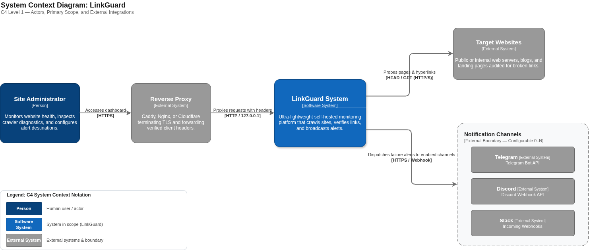
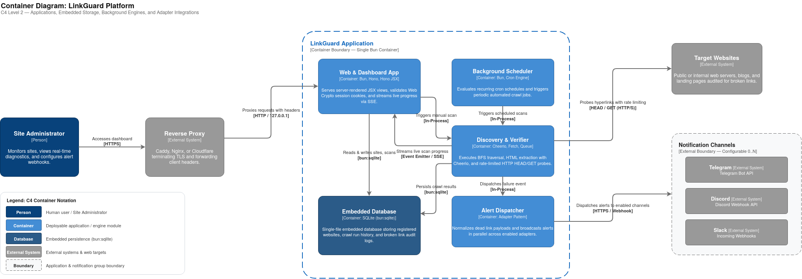

# LinkGuard

> **Ultra-lightweight, self-hosted website health and real-time broken link monitoring platform.**

LinkGuard is an independent, single-container solution designed to run 24/7 on minimal-resource environments (such as budget VPS or entry-level cloud servers) with a sub-128MB RAM footprint. It continuously crawls registered websites, monitors URL health, detects broken links in real time, visualizes link networks, and dispatches instant alerts across multiple chat channels.

---

## Key Features & Value Proposition

- **SEO & Traffic Retention:** Automatically detects 404s, 500s, DNS resolution errors, and expired SSL certificates before they damage search engine rankings and disrupt visitor experiences.
- **Silent Revenue Protection:** Guarantees affiliate links, sponsored references, and product CTA targets remain healthy without manual audits.
- **Zero-Bloat Self-Hosted Architecture:** Replaces heavy, recurring-cost commercial SaaS platforms (Ahrefs, Semrush, Screaming Frog) with a nimble, standalone utility running on modern web standards.
- **Real-Time Live Monitoring:** Emits streaming progress updates via Server-Sent Events (SSE) directly to an interactive dashboard with proxy-buffering protection.
- **Multi-Channel Alert Dispatcher:** Employs an extensible Adapter Pattern to broadcast standardized error payloads in parallel to Telegram, Discord, and Slack without cross-channel blocking.
- **Production-Ready & Reverse-Proxy Aware:** Engineered to sit securely behind reverse proxies (Caddy, Nginx, Cloudflare) with native `X-Forwarded-*` header parsing, loopback isolation (`127.0.0.1`), and zero-dependency Web Crypto HMAC session protection.

---

## Architecture & Data Flow

LinkGuard is designed according to the **C4 Model** to provide clear abstractions across system context and container boundaries:

### 1. System Context Diagram (C4 Level 1)

Shows how LinkGuard fits into the broader operational ecosystem with administrators and external systems. An editable version is available at [docs/diagrams/c4-context.drawio](https://github.com/NgocPMT/linkguard/blob/main/docs/diagrams/c4-context.drawio).

<p align="center">
  
</p>

### 2. Container Diagram (C4 Level 2)

Shows the high-level deployable units and runtime modules inside the LinkGuard application boundary. An editable version is available at [docs/diagrams/c4-container.drawio](https://github.com/NgocPMT/linkguard/blob/main/docs/diagrams/c4-container.drawio).

<p align="center">
  
</p>

### High-Level Execution Lifecycle

1. **Gateway & Protection:** Inbound requests are validated via lightweight, cryptographically signed cookies (HMAC Web Crypto). External access is restricted behind a master credential layer.
2. **Discovery (BFS Crawling):** Breadth-First Search traverses pages starting from the root URL. Static HTML is parsed in milliseconds using Cheerio to extract all anchor tags up to a configured crawl depth.
3. **Verification & Politeness:** Internal and external URLs are evaluated through a rate-limited queue. The engine favors non-destructive `HEAD` probes and falls back to `GET` requests when servers reject `HEAD` methods.
4. **Resilient Alerting:** Identified anomalies are normalized into an `AlertPayload` and delivered concurrently to configured webhook adapters. A network failure in one destination (e.g., Discord) never stalls or disrupts remaining channels.
5. **Real-Time Visualization:** Scan progression and health metrics are streamed continuously to the UI over Server-Sent Events with `X-Accel-Buffering: no` headers to bypass intermediate proxy buffering.

<details>
<summary><b>Text-Based Architecture Diagram (Click to expand)</b></summary>

```
[ User / Web Browser ]
         │ (HTTPS)
         ▼
[ Reverse Proxy (Caddy / Nginx / Cloudflare) ]
         │ (Trust Forwarded Headers / 127.0.0.1)
         ▼
[ Gateway: Master Auth & Session Layer ]
         │
         ├─────────────────────────────────────────┐
         ▼                                         ▼
[ Live Dashboard (Hono JSX) ]             [ Background Scheduler (Cron) ]
  • Server-Sent Events (SSE)                        │
  • Link Network Visualization                      ▼
  • Real-time Scan Progress               [ Discovery Engine (BFS) ]
         ▲                                  • Cheerio Static Parser
         │                                          │
         │ (Live Stream)                            ▼
         │                                [ Verification Engine ]
[ Embedded SQLite (bun:sqlite) ]            • Smart HEAD / GET probes
         ▲                                  • Domain Rate Limiter
         │                                          │
         └──────── (Persist Results) ───────────────┤ (On Broken Link)
                                                    ▼
                                          [ Alert Dispatcher ]
                                            (Adapter Pattern)
                                            ├── Telegram Adapter
                                            ├── Discord Adapter
                                            └── Slack Adapter
```
</details>

---

## Technology Stack & Rationale

| Component | Choice | Technical Rationale |
| :--- | :--- | :--- |
| **Runtime Engine** | **Bun** | High-throughput network I/O, instantaneous process startup, native TypeScript execution without transpilation steps, and integrated high-speed SQLite bindings. |
| **Web Framework** | **Hono** | Ultra-lightweight framework built upon standard Web APIs (`Fetch`, `Request`, `Response`), native Server-Sent Events (`streamSSE`), and low memory overhead. |
| **UI Layer** | **Hono JSX (SSR)** | Server-rendered components (`hono/jsx`) delivering zero-bundle HTML, paired with minimal vanilla JavaScript for real-time DOM hydration via SSE. |
| **HTML Parser** | **Cheerio** | High-speed static DOM parsing with jQuery syntax; consumes a fraction of the memory and CPU required by headless browsers (Playwright/Puppeteer). |
| **Storage Engine** | **Embedded SQLite** | Serverless, single-file database accessed directly through `bun:sqlite`. Eliminates external database containers while providing robust transactions and instantaneous backups. |
| **Security Layer** | **Web Crypto API** | Zero-dependency master password authentication and HMAC-signed session cookies utilizing Bun's native cryptographic primitives. |

---

## Repository Structure

The codebase is organized as a unified, modular monolith:

```text
linkguard/
├── .agents/                    # Agent skills, operational guidelines, and tool configs
├── docs/                       # Project documentation and architectural governance
│   ├── adr/                    # Architecture Decision Records (e.g., 0001-storage-sqlite.md)
│   ├── use-cases/              # Functional use case specifications
│   ├── rfcs/                   # Technical Request for Comments proposals
│   └── diagrams/               # Architecture and container diagrams (.drawio / .png)
│
├── public/                     # Static client-side assets
│   ├── css/
│   │   └── app.css             # Lightweight utility styling
│   └── js/
│       ├── sse-client.js       # Real-time Server-Sent Events client listener
│       └── link-graph.js       # Minimal SVG/Canvas link network visualization
│
├── src/
│   ├── config/                 # Application configuration and type-safe environment variables
│   │   ├── env.ts              # Schema validation and runtime env variables
│   │   └── constants.ts        # Default crawler depth, rate limits, and timeouts
│   │
│   ├── db/                     # Embedded SQLite persistence layer
│   │   ├── client.ts           # Bun:sqlite connection factory
│   │   ├── migrations/         # Raw SQL schema migration scripts
│   │   └── repositories/       # Isolated data access repositories (sites, scans, links, alerts)
│   │
│   ├── core/                   # Domain business logic (runtime framework agnostic)
│   │   ├── crawler/            # Discovery Engine: BFS traversal, HTML parsing, URL normalization
│   │   ├── verifier/           # Verification Engine: HEAD/GET verification, polite rate limiter
│   │   ├── alerts/             # Alert Dispatcher & notification adapters (Telegram, Discord, Slack)
│   │   └── scheduler/          # Background cron scheduler for automated recurring scans
│   │
│   ├── security/               # Authentication and reverse proxy adaptation
│   │   ├── crypto.ts           # HMAC cookie signing and cryptographic verification
│   │   ├── proxy.ts            # Proxy awareness (X-Forwarded-For, X-Forwarded-Proto)
│   │   └── middleware.ts       # Hono route guards and development auth bypass
│   │
│   ├── routes/                 # Hono routing and controllers
│   │   ├── api/                # REST & SSE endpoints (/api/sites, /api/scans, /api/events)
│   │   └── ui/                 # Server-rendered view routes (login, dashboard, site details)
│   │
│   ├── ui/                     # Presentation layer (Hono JSX templates)
│   │   ├── layouts/            # Base HTML shell and shared layouts
│   │   ├── pages/              # Full page templates (Dashboard, SiteDetail, Login)
│   │   └── components/         # Reusable UI micro-components (tables, badges, stat cards)
│   │
│   └── index.ts                # Application entrypoint (assembles Hono, mounts routes, starts scheduler)
│
├── tests/                      # Automated test suites
│   ├── unit/                   # Unit tests for URL normalizer, Cheerio parser, and crypto helpers
│   └── integration/            # In-memory Hono route testing via app.request()
│
├── package.json                # Project dependencies and operational scripts
├── tsconfig.json               # TypeScript compiler configuration (hono/jsx configured)
└── README.md                   # Project overview and architectural blueprint
```

---

## Getting Started

### Prerequisites

- [Bun](https://bun.sh) (v1.1.0 or newer)

### Installation

```sh
# Clone repository
git clone https://github.com/NgocPMT/linkguard.git
cd linkguard

# Install dependencies
bun install
```

### Running Locally

```sh
# Start local development server with hot-reload
bun run dev
```

The application will start on `http://localhost:3000`.

### Testing & Code Quality

```sh
# Run unit and integration test suites
bun test

# Inspect registered routes using the Hono CLI
bunx hono routes
```
