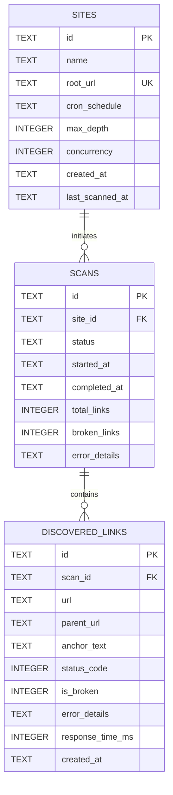

# Database Schema Specification

This document defines the canonical database schema, tables, constraints, and indexes for **LinkGuard (Increment 1: Core Engine & Walking Skeleton)**.

---

## 1. Storage Engine Overview

LinkGuard uses an embedded, serverless storage engine via **SQLite** (accessed natively through `bun:sqlite`). All persistent records reside within a single local file (default: `linkguard.sqlite`), eliminating external database server dependencies.

### SQLite Pragmas & Operational Modes

To ensure high-throughput read operations during active crawl verification, immediate durability, and referential integrity, the connection factory initializes with the following pragmas:

```sql
PRAGMA journal_mode = WAL;         -- Write-Ahead Logging for non-blocking concurrent reads
PRAGMA synchronous = NORMAL;       -- Safe and performant disk synchronization for WAL
PRAGMA foreign_keys = ON;          -- Strict referential integrity enforcement
PRAGMA busy_timeout = 5000;        -- Wait up to 5s during lock contention before failing
```

---

## 2. Entity-Relationship Model



---

## 3. Canonical Table Specifications

### 3.1 `sites`

Stores target websites monitored by LinkGuard along with individual crawl configuration and scheduling rules.

| Column | Type | Constraints | Description |
| :--- | :--- | :--- | :--- |
| `id` | `TEXT` | `PRIMARY KEY` | Unique site identifier (UUID v4 or prefixed slug). |
| `name` | `TEXT` | `NOT NULL` | Human-readable site label or display name. |
| `root_url` | `TEXT` | `NOT NULL UNIQUE` | Normalized crawl origin (must begin with `http://` or `https://`). |
| `cron_schedule` | `TEXT` | `NOT NULL` | Standard 5-field cron expression (e.g. `0 2 * * *` for daily at 02:00 UTC). |
| `max_depth` | `INTEGER` | `NOT NULL DEFAULT 3` | Maximum internal BFS recursive crawl depth limit. |
| `concurrency` | `INTEGER` | `NOT NULL DEFAULT 5` | Maximum concurrent HTTP probe requests sent to this domain. |
| `created_at` | `TEXT` | `NOT NULL` | ISO 8601 UTC creation timestamp (`YYYY-MM-DDTHH:mm:ss.sssZ`). |
| `last_scanned_at` | `TEXT` | `NULL` | ISO 8601 UTC timestamp of the most recent completed crawl. |

---

### 3.2 `scans`

Represents discrete crawl executions (manual or scheduled) against a target website.

| Column | Type | Constraints | Description |
| :--- | :--- | :--- | :--- |
| `id` | `TEXT` | `PRIMARY KEY` | Unique scan execution identifier. |
| `site_id` | `TEXT` | `NOT NULL REFERENCES sites(id) ON DELETE CASCADE` | Foreign key referencing the parent site. |
| `status` | `TEXT` | `NOT NULL CHECK(status IN ('pending', 'running', 'completed', 'failed'))` | Current lifecycle state of the crawl job. |
| `started_at` | `TEXT` | `NOT NULL` | ISO 8601 UTC start timestamp. |
| `completed_at` | `TEXT` | `NULL` | ISO 8601 UTC completion timestamp (null while running). |
| `total_links` | `INTEGER` | `NOT NULL DEFAULT 0` | Total number of links verified during this scan. |
| `broken_links` | `INTEGER` | `NOT NULL DEFAULT 0` | Total number of broken/anomalous links identified. |
| `error_details` | `TEXT` | `NULL` | Root failure explanation if scan status is `'failed'` (e.g. DNS resolution failure). |

---

### 3.3 `discovered_links`

Stores individual link occurrences identified during a scan, capturing source origin, target destination, anchor text, and verification outcome.

| Column | Type | Constraints | Description |
| :--- | :--- | :--- | :--- |
| `id` | `TEXT` | `PRIMARY KEY` | Unique link occurrence identifier. |
| `scan_id` | `TEXT` | `NOT NULL REFERENCES scans(id) ON DELETE CASCADE` | Foreign key referencing the parent scan execution. |
| `url` | `TEXT` | `NOT NULL` | Fully qualified target URL probed. |
| `parent_url` | `TEXT` | `NOT NULL` | URL of the page containing the anchor tag where this link was found. |
| `anchor_text` | `TEXT` | `NULL` | Visible text content of the anchor tag (`<a>Text</a>`). |
| `status_code` | `INTEGER` | `NULL` | HTTP response status code (e.g., 200, 404, 500; `NULL` on network/DNS errors). |
| `is_broken` | `INTEGER` | `NOT NULL CHECK(is_broken IN (0, 1))` | Boolean flag (`1` = broken / error, `0` = healthy). |
| `error_details` | `TEXT` | `NULL` | Failure reason (e.g., `'404 Not Found'`, `'ETIMEDOUT'`, `'ECONNREFUSED'`). |
| `response_time_ms`| `INTEGER` | `NULL` | Network latency / verification probe duration in milliseconds. |
| `created_at` | `TEXT` | `NOT NULL` | ISO 8601 UTC discovery timestamp. |

---

## 4. Performance Indexes

To support high-frequency filtering, dashboard lookups, and graph visualization:

```sql
-- Enforce unique root URL search efficiency
CREATE UNIQUE INDEX idx_sites_root_url ON sites(root_url);

-- Fast lookup of scan history for a site ordered by start time
CREATE INDEX idx_scans_site_started ON scans(site_id, started_at DESC);

-- Fast dashboard filtering for broken links in a scan (UC-06 filter toggle)
CREATE INDEX idx_discovered_links_scan_broken ON discovered_links(scan_id, is_broken);

-- Fast page-level drilldowns and link network graph visualization
CREATE INDEX idx_discovered_links_scan_parent ON discovered_links(scan_id, parent_url);
```

---

## 5. Canonical DDL Script

```sql
-- Sites Table
CREATE TABLE IF NOT EXISTS sites (
    id TEXT PRIMARY KEY,
    name TEXT NOT NULL,
    root_url TEXT NOT NULL UNIQUE,
    cron_schedule TEXT NOT NULL,
    max_depth INTEGER NOT NULL DEFAULT 3,
    concurrency INTEGER NOT NULL DEFAULT 5,
    created_at TEXT NOT NULL,
    last_scanned_at TEXT
);

-- Scans Table
CREATE TABLE IF NOT EXISTS scans (
    id TEXT PRIMARY KEY,
    site_id TEXT NOT NULL,
    status TEXT NOT NULL CHECK(status IN ('pending', 'running', 'completed', 'failed')),
    started_at TEXT NOT NULL,
    completed_at TEXT,
    total_links INTEGER NOT NULL DEFAULT 0,
    broken_links INTEGER NOT NULL DEFAULT 0,
    error_details TEXT,
    FOREIGN KEY (site_id) REFERENCES sites(id) ON DELETE CASCADE
);

-- Discovered Links Table
CREATE TABLE IF NOT EXISTS discovered_links (
    id TEXT PRIMARY KEY,
    scan_id TEXT NOT NULL,
    url TEXT NOT NULL,
    parent_url TEXT NOT NULL,
    anchor_text TEXT,
    status_code INTEGER,
    is_broken INTEGER NOT NULL CHECK(is_broken IN (0, 1)),
    error_details TEXT,
    response_time_ms INTEGER,
    created_at TEXT NOT NULL,
    FOREIGN KEY (scan_id) REFERENCES scans(id) ON DELETE CASCADE
);

-- Indexes
CREATE UNIQUE INDEX IF NOT EXISTS idx_sites_root_url ON sites(root_url);
CREATE INDEX IF NOT EXISTS idx_scans_site_started ON scans(site_id, started_at DESC);
CREATE INDEX IF NOT EXISTS idx_discovered_links_scan_broken ON discovered_links(scan_id, is_broken);
CREATE INDEX IF NOT EXISTS idx_discovered_links_scan_parent ON discovered_links(scan_id, parent_url);
```
