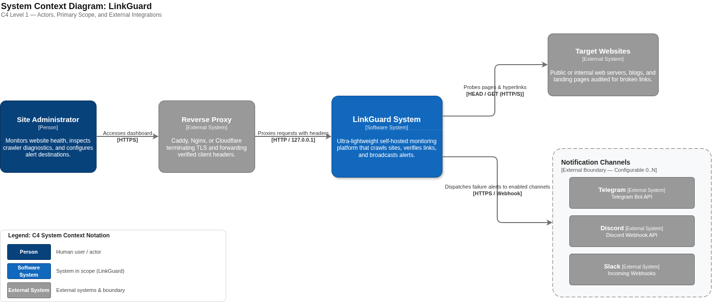
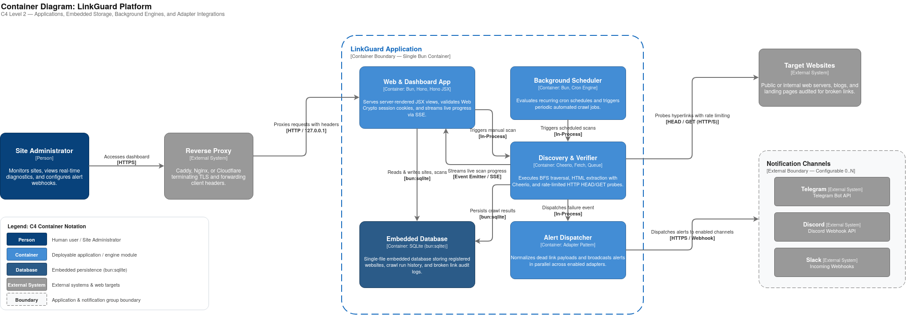

# LinkGuard System Architecture & Design Overview

> **Ultra-lightweight, self-hosted website health and real-time broken link monitoring platform.**

LinkGuard is an independent, single-process solution designed to operate 24/7 on resource-constrained environments (such as budget VPS or entry-level cloud servers) with a sub-128MB RAM footprint. It continuously crawls registered websites, monitors URL health, detects broken links in real time, and exposes an intuitive administrative interface.

---

## 1. Architectural Principles

* **Zero-Bloat Architecture:** Minimal CPU and RAM utilization. Eliminates heavy external daemon dependencies (no separate database server, no background worker containers, no browser-automation overhead).
* **Production-Ready & Reverse-Proxy Aware:** Out of the box, the system binds securely to loopback (`127.0.0.1`), respects standard reverse-proxy forwarding headers (`X-Forwarded-For`, `X-Forwarded-Proto`), and prevents proxy buffer stall via `X-Accel-Buffering: no`.
* **Embedded Persistence:** All application state, crawl job histories, and link discoveries are stored in an embedded SQLite database operating in WAL mode.
* **Separation of Concerns:** Discovery (BFS HTML parsing), Verification (HTTP probes), Storage (SQLite repositories), and Presentation (Hono JSX) remain strictly decoupled.

---

## 2. Technical Contracts & Detailed Specifications

The detailed data and interface contracts supporting this architecture are documented in dedicated specifications:

* 🗄️ **[Database Schema Specification](./database-schema.md):** Canonical SQLite DDL, table relationships (`sites`, `scans`, `discovered_links`), constraints, and performance indexes.
* 🔌 **[REST API Contract Specification](./api-spec.md):** Canonical HTTP verbs, payload schemas, query parameters, status codes, and error envelopes.

---

## 3. C4 Architecture Models

LinkGuard is designed according to the **C4 Model** for clear abstraction of software architecture:

### 3.1 System Context (C4 Level 1)

Shows how LinkGuard sits within the operational ecosystem, interacting with administrators and external systems. An editable Draw.io diagram is available at [`docs/diagrams/c4-context.drawio`](../diagrams/c4-context.drawio).

<p align="center">
  
</p>

* **System Administrator:** Interacts with LinkGuard through the server-rendered Web UI to configure target sites, trigger crawls, and review link health reports.
* **LinkGuard Platform:** The core self-hosted application.
* **Target Web Servers:** Remote or internal web servers hosting the pages and resources being audited.
* **Reverse Proxy (Caddy / Nginx / Cloudflare):** Terminates TLS, forwards client headers, and proxies requests to LinkGuard's internal loopback socket.
* **Alerting Channels (Telegram / Discord / Slack):** Downstream notification targets for alerts (introduced in subsequent increments).

---

### 3.2 Container & Component Architecture (C4 Level 2)

Shows the high-level deployable units and internal runtime modules within the LinkGuard application boundary. An editable Draw.io diagram is available at [`docs/diagrams/c4-container.drawio`](../diagrams/c4-container.drawio).

<p align="center">
  
</p>

```
[ User / Browser ]
         │ (HTTPS)
         ▼
[ Reverse Proxy (Caddy / Nginx / Cloudflare) ]
         │ (127.0.0.1:3000 / Forwarded Headers)
         ▼
[ Gateway & Security Layer ]
  • proxyMiddleware (trusted header resolution)
  • authMiddleware (HMAC Web Crypto session guard)
  • loggerMiddleware & errorHandler
         │
         ├─────────────────────────────────────────┐
         ▼                                         ▼
[ Web Presentation & API Layer ]          [ Background Scheduler (Cron) ]
  • Server-Rendered UI (Hono JSX)                   │ (Evaluates site cron)
  • REST API Controllers                            ▼
  • Server-Sent Events (SSE Stream)       [ Discovery Engine (BFS) ]
         ▲                                  • Cheerio Static Parser
         │                                  • Domain & Depth Boundary Filter
         │                                          │
         │                                          ▼
         │                                [ Verification Engine ]
         │                                  • Smart HEAD / GET Probes
         │                                  • Concurrency Throttling
         │                                  • 5-Hop Redirect Follower
         │                                          │
         ├──────────────────────────────────────────┤ (Persist Records)
         ▼                                          ▼
[ Embedded Persistence Layer (bun:sqlite) ]
  • sites, scans, discovered_links tables
  • WAL journal mode & foreign key enforcement
```

---

## 4. End-to-End Execution Lifecycle

The core scanning and reporting workflow follows a 6-stage pipeline:

1. **Target Registration:**
   * The administrator registers a target website via the UI or API (`POST /api/sites`).
   * LinkGuard normalizes the root URL (validates `http/https`, strips fragment hashes and trailing slashes) and persists the site record with its cron schedule and crawl limits.

2. **Crawl Job Trigger & Lock Acquisition:**
   * A crawl is triggered either manually (`POST /api/sites/:id/scans`) or automatically by the in-process cron scheduler.
   * LinkGuard checks for an active scan lock on the site. If a crawl is already running for this site, the request is rejected with `409 Conflict` (or skipped by the scheduler).
   * A new scan record is created with `status: 'running'`, and the job runs asynchronously in the background.

3. **Discovery (BFS Crawling):**
   * The crawler fetches the site's root page and parses static HTML using Cheerio.
   * All anchor tags (`<a href="...">`) are extracted and normalized against the base URL.
   * Internal links are queued for recursive traversal up to `max_depth`.
   * Non-HTTP protocols (`mailto:`, `tel:`, `javascript:`, `#`) are bypassed.

4. **Verification & HTTP Probing:**
   * URLs are verified using a concurrency-limited worker queue.
   * Probing uses **Smart Fallback**: issues a lightweight `HEAD` request first; if the target server rejects `HEAD` (405 Method Not Allowed / 403 Forbidden / 501 Not Implemented), it automatically falls back to a streamed `GET` request.
   * Redirects (3xx) are followed up to 5 hops to evaluate the final destination.
   * Unique URLs are verified once per scan (in-memory cache), but each occurrence is captured with its `parent_url` and `anchor_text`.

5. **Persistence & Metric Aggregation:**
   * Discovered links are recorded in SQLite (`discovered_links`).
   * A link is flagged as broken (`is_broken = 1`) if its final status code is `≥ 400`, or if a network timeout (10s), DNS resolution error (`ENOTFOUND`), connection refusal (`ECONNREFUSED`), or redirect loop occurs.
   * Upon queue exhaustion, the scan status transitions to `'completed'` (or `'failed'` if the root URL was unreachable), and `total_links` and `broken_links` counters are updated.

6. **Reporting & Visualization:**
   * The administrator reviews the high-level scan summary (UC-05) and inspects broken links in the filterable link report (UC-06).

---

## 5. Technology Stack & Technical Rationale

| Component | Technology | Rationale |
| :--- | :--- | :--- |
| **Runtime Engine** | **Bun** | High-performance network I/O, rapid startup times, native TypeScript execution without transpilation steps, and built-in SQLite bindings. |
| **Web Framework** | **Hono** | Lightweight framework built entirely on Web Standards (`Request`, `Response`, `Fetch`), native Server-Sent Events support, and negligible memory overhead. |
| **UI Presentation** | **Hono JSX (SSR)** | Zero-bundle HTML rendering on the server, paired with lightweight vanilla JavaScript for dynamic client-side interactions. |
| **HTML Parser** | **Cheerio** | Sub-millisecond static DOM parsing using standard jQuery selectors; uses a fraction of the RAM/CPU demanded by headless browser engines (Puppeteer/Playwright). |
| **Storage Engine** | **SQLite (Embedded)** | Single-file embedded database managed via `bun:sqlite`. Eliminates external DB containers, supports WAL mode for fast concurrency, and provides atomic backups. |
| **Security Layer** | **Web Crypto API** | Zero-dependency cryptographic primitives using Bun's native implementation for HMAC SHA-256 session token signing and constant-time comparisons. |
